<!-- Generated by scripts/gen-doc-graphs.ts - do not edit by hand.
     Run `pnpm run gen-doc-graphs` to regenerate. -->

# DSH Base Composition

The dsh-base bundle patch every profile applies first; mode bundles (dsh-web-app, dsh-headless) and the user's profile layer patch over it.

```mermaid
flowchart LR
  cfg["packages/bundle/base/cordis.patch.yml<br/>cordis.yml"]
  plugin_dsh_base_timer["timer<br/>@deepseek-ai/cordis-plugin-timer"]
  cfg --> plugin_dsh_base_timer
  plugin_dsh_base_hmr["hmr<br/>@deepseek-ai/cordis-plugin-hmr"]
  cfg --> plugin_dsh_base_hmr
  plugin_dsh_base_llm["llm<br/>coding-llm"]
  cfg --> plugin_dsh_base_llm
  plugin_dsh_base_session["session<br/>coding-session"]
  cfg --> plugin_dsh_base_session
  plugin_dsh_base_typert["typert<br/>coding-typert-registry"]
  cfg --> plugin_dsh_base_typert
  plugin_dsh_base_typert_loader["typert-loader<br/>coding-typert-loader"]
  cfg --> plugin_dsh_base_typert_loader
  plugin_dsh_base_typert_gateway["typert-gateway<br/>coding-api-gateway"]
  cfg --> plugin_dsh_base_typert_gateway
  plugin_dsh_base_session_title["session-title<br/>coding-session-title"]
  cfg --> plugin_dsh_base_session_title
  plugin_dsh_base_session_title_llm["session-title-llm<br/>coding-session-title-first-prompt-llm"]
  cfg --> plugin_dsh_base_session_title_llm
  plugin_dsh_base_user_questions["user-questions<br/>coding-user-questions"]
  cfg --> plugin_dsh_base_user_questions
  plugin_dsh_base_agent["agent<br/>coding-agent"]
  cfg --> plugin_dsh_base_agent
  plugin_dsh_base_agent_default_model["agent-default-model<br/>coding-agent-default-model"]
  cfg --> plugin_dsh_base_agent_default_model
  plugin_dsh_base_jobs["jobs<br/>coding-jobs-local"]
  cfg --> plugin_dsh_base_jobs
  plugin_dsh_base_llm_retry["llm-retry<br/>coding-llm-retry"]
  cfg --> plugin_dsh_base_llm_retry
  plugin_dsh_base_llm_vision_fallback["llm-vision-fallback<br/>coding-llm-vision-fallback"]
  cfg --> plugin_dsh_base_llm_vision_fallback
  plugin_dsh_base_settings["settings<br/>coding-settings-file"]
  cfg --> plugin_dsh_base_settings
  plugin_dsh_base_credentials["credentials<br/>coding-credentials-local"]
  cfg --> plugin_dsh_base_credentials
  plugin_dsh_base_llm_pi_ai["llm-pi-ai<br/>coding-llm-pi-ai"]
  cfg --> plugin_dsh_base_llm_pi_ai
  plugin_dsh_base_proxy_pool["proxy-pool<br/>coding-proxy-pool"]
  cfg --> plugin_dsh_base_proxy_pool
  plugin_dsh_base_llm_opencode["llm-opencode<br/>coding-llm-opencode"]
  cfg --> plugin_dsh_base_llm_opencode
  plugin_dsh_base_session_persistence_jsonl["session-persistence-jsonl<br/>coding-session-persistence-jsonl"]
  cfg --> plugin_dsh_base_session_persistence_jsonl
  plugin_dsh_base_attachment_local["attachment-local<br/>coding-attachment-local"]
  cfg --> plugin_dsh_base_attachment_local
  plugin_dsh_base_session_query_sqlite["session-query-sqlite<br/>coding-session-query-sqlite"]
  cfg --> plugin_dsh_base_session_query_sqlite
  plugin_dsh_base_session_projection["session-projection<br/>coding-session-projection"]
  cfg --> plugin_dsh_base_session_projection
  plugin_dsh_base_session_telemetry_otel["session-telemetry-otel<br/>coding-session-telemetry-otel"]
  cfg --> plugin_dsh_base_session_telemetry_otel
  plugin_dsh_base_subprocess["subprocess<br/>coding-subprocess-local"]
  cfg --> plugin_dsh_base_subprocess
  plugin_dsh_base_sandbox["sandbox<br/>coding-sandbox-local"]
  cfg --> plugin_dsh_base_sandbox
  plugin_dsh_base_sandbox_policy["sandbox-policy<br/>coding-sandbox-policy"]
  cfg --> plugin_dsh_base_sandbox_policy
  plugin_dsh_base_bash_sandbox["bash-sandbox<br/>coding-bash-sandbox"]
  cfg --> plugin_dsh_base_bash_sandbox
  plugin_dsh_base_pwsh_sandbox["pwsh-sandbox<br/>coding-pwsh-sandbox"]
  cfg --> plugin_dsh_base_pwsh_sandbox
  plugin_dsh_base_approval["approval<br/>coding-user-approval"]
  cfg --> plugin_dsh_base_approval
  plugin_dsh_base_permission["permission<br/>coding-permission-presets"]
  cfg --> plugin_dsh_base_permission
  plugin_dsh_base_shell_env["shell-env<br/>coding-shell-env"]
  cfg --> plugin_dsh_base_shell_env
  plugin_dsh_base_tool_bash["tool-bash<br/>coding-tool-bash"]
  cfg --> plugin_dsh_base_tool_bash
  plugin_dsh_base_tool_pwsh["tool-pwsh<br/>coding-tool-pwsh"]
  cfg --> plugin_dsh_base_tool_pwsh
  plugin_dsh_base_tool_jobs["tool-jobs<br/>coding-tool-jobs"]
  cfg --> plugin_dsh_base_tool_jobs
  plugin_dsh_base_fs_observation_policy["fs-observation-policy<br/>coding-fs-observation-policy"]
  cfg --> plugin_dsh_base_fs_observation_policy
  plugin_dsh_base_tool_fs["tool-fs<br/>coding-tool-fs"]
  cfg --> plugin_dsh_base_tool_fs
  plugin_dsh_base_tool_apply_patch["tool-apply-patch<br/>coding-tool-apply-patch"]
  cfg --> plugin_dsh_base_tool_apply_patch
  plugin_dsh_base_tool_fs_search["tool-fs-search<br/>coding-tool-fs-search"]
  cfg --> plugin_dsh_base_tool_fs_search
  plugin_dsh_base_agent_instructions["agent-instructions<br/>coding-agent-instructions"]
  cfg --> plugin_dsh_base_agent_instructions
  plugin_dsh_base_memory_local["memory-local<br/>coding-memory-local"]
  cfg --> plugin_dsh_base_memory_local
  plugin_dsh_base_memory_context["memory-context<br/>coding-memory-context"]
  cfg --> plugin_dsh_base_memory_context
  plugin_dsh_base_tool_memory["tool-memory<br/>coding-tool-memory"]
  cfg --> plugin_dsh_base_tool_memory
  plugin_dsh_base_skill["skill<br/>coding-skill"]
  cfg --> plugin_dsh_base_skill
  plugin_dsh_base_skill_filesystem["skill-filesystem<br/>coding-skill-filesystem"]
  cfg --> plugin_dsh_base_skill_filesystem
  plugin_dsh_base_skill_badge["skill-badge<br/>coding-skill-badge"]
  cfg --> plugin_dsh_base_skill_badge
  plugin_dsh_base_tool_skill["tool-skill<br/>coding-tool-skill"]
  cfg --> plugin_dsh_base_tool_skill
  plugin_dsh_base_commands["commands<br/>coding-commands"]
  cfg --> plugin_dsh_base_commands
  plugin_dsh_base_command_feedback["command-feedback<br/>coding-command-feedback"]
  cfg --> plugin_dsh_base_command_feedback
  plugin_dsh_base_goal["goal<br/>coding-goal"]
  cfg --> plugin_dsh_base_goal
  plugin_dsh_base_goal_round_driver["goal-round-driver<br/>coding-goal-round-driver"]
  cfg --> plugin_dsh_base_goal_round_driver
  plugin_dsh_base_command_goal["command-goal<br/>coding-command-goal"]
  cfg --> plugin_dsh_base_command_goal
  plugin_dsh_base_plan_mode["plan-mode<br/>coding-plan-mode"]
  cfg --> plugin_dsh_base_plan_mode
  plugin_dsh_base_token_meter["token-meter<br/>coding-token-meter"]
  cfg --> plugin_dsh_base_token_meter
  plugin_dsh_base_compaction_basic["compaction-basic<br/>coding-compaction-basic"]
  cfg --> plugin_dsh_base_compaction_basic
  plugin_dsh_base_command_compact["command-compact<br/>coding-command-compact"]
  cfg --> plugin_dsh_base_command_compact
  plugin_dsh_base_subagent["subagent<br/>coding-subagent"]
  cfg --> plugin_dsh_base_subagent
  plugin_dsh_base_subagent_spawn_in_process["subagent-spawn-in-process<br/>coding-subagent-spawn-in-process"]
  cfg --> plugin_dsh_base_subagent_spawn_in_process
  plugin_dsh_base_subagent_fork_in_process["subagent-fork-in-process<br/>coding-subagent-fork-in-process"]
  cfg --> plugin_dsh_base_subagent_fork_in_process
  plugin_dsh_base_tool_subagent_control["tool-subagent-control<br/>coding-tool-subagent-control"]
  cfg --> plugin_dsh_base_tool_subagent_control
  plugin_dsh_base_tool_subagent_list_agents["tool-subagent-list-agents<br/>coding-tool-subagent-control/list-agents"]
  cfg --> plugin_dsh_base_tool_subagent_list_agents
  plugin_dsh_base_tool_subagent_list_models["tool-subagent-list-models<br/>coding-tool-subagent-control/list-models"]
  cfg --> plugin_dsh_base_tool_subagent_list_models
  plugin_dsh_base_tool_subagent["tool-subagent<br/>coding-tool-subagent"]
  cfg --> plugin_dsh_base_tool_subagent
  plugin_dsh_base_tool_subagent_fork["tool-subagent-fork<br/>coding-tool-subagent"]
  cfg --> plugin_dsh_base_tool_subagent_fork
  plugin_dsh_base_tool_subagent_report["tool-subagent-report<br/>coding-tool-subagent-report"]
  cfg --> plugin_dsh_base_tool_subagent_report
  plugin_dsh_base_workflow_worker_thread["workflow-worker-thread<br/>coding-workflow-worker-thread"]
  cfg --> plugin_dsh_base_workflow_worker_thread
  plugin_dsh_base_tool_workflow["tool-workflow<br/>coding-tool-workflow"]
  cfg --> plugin_dsh_base_tool_workflow
  plugin_dsh_base_timeout_policy["timeout-policy<br/>coding-tool-call-timeout-policy"]
  cfg --> plugin_dsh_base_timeout_policy
  plugin_dsh_base_spill_local["spill-local<br/>coding-spill-local"]
  cfg --> plugin_dsh_base_spill_local
  plugin_dsh_base_spill_policy["spill-policy<br/>coding-spill-policy"]
  cfg --> plugin_dsh_base_spill_policy
  plugin_dsh_base_session_checkpoint_policy["session-checkpoint-policy<br/>coding-session-checkpoint-policy"]
  cfg --> plugin_dsh_base_session_checkpoint_policy
  plugin_dsh_base_tool_result_pruner["tool-result-pruner<br/>coding-compaction-tool-result-pruner"]
  cfg --> plugin_dsh_base_tool_result_pruner
  plugin_dsh_base_tool_todo["tool-todo<br/>coding-tool-todo"]
  cfg --> plugin_dsh_base_tool_todo
  plugin_dsh_base_tool_goal["tool-goal<br/>coding-tool-goal"]
  cfg --> plugin_dsh_base_tool_goal
  plugin_dsh_base_tool_ralph["tool-ralph<br/>coding-tool-ralph"]
  cfg --> plugin_dsh_base_tool_ralph
  plugin_dsh_base_tool_str_replace_editor["tool-str-replace-editor<br/>coding-tool-str-replace-editor"]
  cfg --> plugin_dsh_base_tool_str_replace_editor
  plugin_dsh_base_repeat_tool_reminder["repeat-tool-reminder<br/>coding-repeat-tool-reminder"]
  cfg --> plugin_dsh_base_repeat_tool_reminder
  plugin_dsh_base_progress_reminder["progress-reminder<br/>coding-progress-reminder"]
  cfg --> plugin_dsh_base_progress_reminder
  plugin_dsh_base_web["web<br/>coding-web"]
  cfg --> plugin_dsh_base_web
  plugin_dsh_base_web_search_duckduckgo["web-search-duckduckgo<br/>coding-web-search-duckduckgo"]
  cfg --> plugin_dsh_base_web_search_duckduckgo
  plugin_dsh_base_web_search_bing["web-search-bing<br/>coding-web-search-bing"]
  cfg --> plugin_dsh_base_web_search_bing
  plugin_dsh_base_web_search_searxng["web-search-searxng<br/>coding-web-search-searxng"]
  cfg --> plugin_dsh_base_web_search_searxng
  plugin_dsh_base_web_search_anysearch["web-search-anysearch<br/>coding-web-search-anysearch"]
  cfg --> plugin_dsh_base_web_search_anysearch
  plugin_dsh_base_web_search_firecrawl["web-search-firecrawl<br/>coding-web-search-firecrawl"]
  cfg --> plugin_dsh_base_web_search_firecrawl
  plugin_dsh_base_web_search_keenable["web-search-keenable<br/>coding-web-search-keenable"]
  cfg --> plugin_dsh_base_web_search_keenable
  plugin_dsh_base_web_search_parallel["web-search-parallel<br/>coding-web-search-parallel"]
  cfg --> plugin_dsh_base_web_search_parallel
  plugin_dsh_base_web_search_deepseek["web-search-deepseek<br/>coding-web-search-deepseek"]
  cfg --> plugin_dsh_base_web_search_deepseek
  plugin_dsh_base_web_search_tavily["web-search-tavily<br/>coding-web-search-tavily"]
  cfg --> plugin_dsh_base_web_search_tavily
  plugin_dsh_base_browser_playwright["browser-playwright<br/>coding-browser-playwright"]
  cfg --> plugin_dsh_base_browser_playwright
  plugin_dsh_base_browser_electron["browser-electron<br/>coding-browser-electron"]
  cfg --> plugin_dsh_base_browser_electron
  plugin_dsh_base_tool_web["tool-web<br/>coding-tool-web"]
  cfg --> plugin_dsh_base_tool_web
  plugin_dsh_base_tools["tools<br/>coding-tools"]
  cfg --> plugin_dsh_base_tools
  plugin_dsh_base_system_prompt["system-prompt<br/>coding-system-prompt"]
  cfg --> plugin_dsh_base_system_prompt
  plugin_dsh_base_agent_loop["agent-loop<br/>coding-agent-loop"]
  cfg --> plugin_dsh_base_agent_loop
  plugin_dsh_base_fs_workspace["fs-workspace<br/>coding-fs-workspace"]
  cfg --> plugin_dsh_base_fs_workspace
  plugin_dsh_base_llm_deepseek["llm-deepseek<br/>coding-llm-deepseek"]
  cfg --> plugin_dsh_base_llm_deepseek
```

| Plugin id | Package / module |
| --- | --- |
| `timer` | `@deepseek-ai/cordis-plugin-timer` |
| `hmr` | `@deepseek-ai/cordis-plugin-hmr` |
| `llm` | `coding-llm` |
| `session` | `coding-session` |
| `typert` | `coding-typert-registry` |
| `typert-loader` | `coding-typert-loader` |
| `typert-gateway` | `coding-api-gateway` |
| `session-title` | `coding-session-title` |
| `session-title-llm` | `coding-session-title-first-prompt-llm` |
| `user-questions` | `coding-user-questions` |
| `agent` | `coding-agent` |
| `agent-default-model` | `coding-agent-default-model` |
| `jobs` | `coding-jobs-local` |
| `llm-retry` | `coding-llm-retry` |
| `llm-vision-fallback` | `coding-llm-vision-fallback` |
| `settings` | `coding-settings-file` |
| `credentials` | `coding-credentials-local` |
| `llm-pi-ai` | `coding-llm-pi-ai` |
| `proxy-pool` | `coding-proxy-pool` |
| `llm-opencode` | `coding-llm-opencode` |
| `session-persistence-jsonl` | `coding-session-persistence-jsonl` |
| `attachment-local` | `coding-attachment-local` |
| `session-query-sqlite` | `coding-session-query-sqlite` |
| `session-projection` | `coding-session-projection` |
| `session-telemetry-otel` | `coding-session-telemetry-otel` |
| `subprocess` | `coding-subprocess-local` |
| `sandbox` | `coding-sandbox-local` |
| `sandbox-policy` | `coding-sandbox-policy` |
| `bash-sandbox` | `coding-bash-sandbox` |
| `pwsh-sandbox` | `coding-pwsh-sandbox` |
| `approval` | `coding-user-approval` |
| `permission` | `coding-permission-presets` |
| `shell-env` | `coding-shell-env` |
| `tool-bash` | `coding-tool-bash` |
| `tool-pwsh` | `coding-tool-pwsh` |
| `tool-jobs` | `coding-tool-jobs` |
| `fs-observation-policy` | `coding-fs-observation-policy` |
| `tool-fs` | `coding-tool-fs` |
| `tool-apply-patch` | `coding-tool-apply-patch` |
| `tool-fs-search` | `coding-tool-fs-search` |
| `agent-instructions` | `coding-agent-instructions` |
| `memory-local` | `coding-memory-local` |
| `memory-context` | `coding-memory-context` |
| `tool-memory` | `coding-tool-memory` |
| `skill` | `coding-skill` |
| `skill-filesystem` | `coding-skill-filesystem` |
| `skill-badge` | `coding-skill-badge` |
| `tool-skill` | `coding-tool-skill` |
| `commands` | `coding-commands` |
| `command-feedback` | `coding-command-feedback` |
| `goal` | `coding-goal` |
| `goal-round-driver` | `coding-goal-round-driver` |
| `command-goal` | `coding-command-goal` |
| `plan-mode` | `coding-plan-mode` |
| `token-meter` | `coding-token-meter` |
| `compaction-basic` | `coding-compaction-basic` |
| `command-compact` | `coding-command-compact` |
| `subagent` | `coding-subagent` |
| `subagent-spawn-in-process` | `coding-subagent-spawn-in-process` |
| `subagent-fork-in-process` | `coding-subagent-fork-in-process` |
| `tool-subagent-control` | `coding-tool-subagent-control` |
| `tool-subagent-list-agents` | `coding-tool-subagent-control/list-agents` |
| `tool-subagent-list-models` | `coding-tool-subagent-control/list-models` |
| `tool-subagent` | `coding-tool-subagent` |
| `tool-subagent-fork` | `coding-tool-subagent` |
| `tool-subagent-report` | `coding-tool-subagent-report` |
| `workflow-worker-thread` | `coding-workflow-worker-thread` |
| `tool-workflow` | `coding-tool-workflow` |
| `timeout-policy` | `coding-tool-call-timeout-policy` |
| `spill-local` | `coding-spill-local` |
| `spill-policy` | `coding-spill-policy` |
| `session-checkpoint-policy` | `coding-session-checkpoint-policy` |
| `tool-result-pruner` | `coding-compaction-tool-result-pruner` |
| `tool-todo` | `coding-tool-todo` |
| `tool-goal` | `coding-tool-goal` |
| `tool-ralph` | `coding-tool-ralph` |
| `tool-str-replace-editor` | `coding-tool-str-replace-editor` |
| `repeat-tool-reminder` | `coding-repeat-tool-reminder` |
| `progress-reminder` | `coding-progress-reminder` |
| `web` | `coding-web` |
| `web-search-duckduckgo` | `coding-web-search-duckduckgo` |
| `web-search-bing` | `coding-web-search-bing` |
| `web-search-searxng` | `coding-web-search-searxng` |
| `web-search-anysearch` | `coding-web-search-anysearch` |
| `web-search-firecrawl` | `coding-web-search-firecrawl` |
| `web-search-keenable` | `coding-web-search-keenable` |
| `web-search-parallel` | `coding-web-search-parallel` |
| `web-search-deepseek` | `coding-web-search-deepseek` |
| `web-search-tavily` | `coding-web-search-tavily` |
| `browser-playwright` | `coding-browser-playwright` |
| `browser-electron` | `coding-browser-electron` |
| `tool-web` | `coding-tool-web` |
| `tools` | `coding-tools` |
| `system-prompt` | `coding-system-prompt` |
| `agent-loop` | `coding-agent-loop` |
| `fs-workspace` | `coding-fs-workspace` |
| `llm-deepseek` | `coding-llm-deepseek` |

Source config: [`packages/bundle/base/cordis.patch.yml`](../../packages/bundle/base/cordis.patch.yml).

Maintenance mode: hybrid: the leaf plugin list is parsed from its `cordis.yml`; app package expansion is curated from package source.
